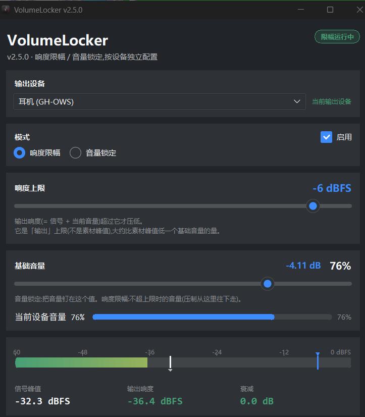

# VolumeLocker

[](#)
[](#)
[](LICENSE)

**Windows 响度限幅器:爆炸不再吓人,安静时不动音量。**

它实时盯住**输出响度**:一旦超过你设的上限(默认 −6 dBFS),就在几毫秒内把
系统音量压下去,过后再缓缓放回。看剧时枪炮声不再炸耳,对白该多大还是多大。

灵感来自 [Sound Lock](https://sound-lock.en.softonic.com)(eibol),但控制律
与它不同——本项目控制的是"输出响度 = 信号 + 当前音量"这个物理量,并把攻击、
释放、迟滞、滤波全部拆成了可独立验证的纯逻辑模块。设计取舍与实测数据见
[docs/开发踩坑记录.md](docs/开发踩坑记录.md)。



## 特性

- **响度限幅**:按输出响度压制,安静段零干预;压制 8ms 内生效(一拍完成)
- **音量锁定**(可选):把音量钉在固定值上
- **按设备独立配置**:上限、基础音量、释放速率、保持时间、音量平滑逐设备记忆
- **实时电平表**:信号峰值 / 输出响度 / 当前衰减一目了然,上限线越线即红
- **深浅两套主题**,纯 Python 自绘控件,轻量模式(`VOLUMELOCKER_LITE=1`)可再省 ~10MB 内存
- **托盘常驻 + 开机自启**(自启为静默模式,只进托盘不弹窗)
- 单文件 exe,免安装

## 工作原理

```
峰值表(信号) ──► 控制律 ──► 目标音量 ──► 写系统音量
                     ▲                        │
                     └──── 输出响度 = 信号 + 音量 ◄──┘
```

用 WASAPI 峰值表读信号、写端点音量实现闭环,控制环节拍 8ms。这是**包络级**
压制:能挡住爆炸、枪声这类响度冲击,但不是样本级限幅器(单个样本内的过冲
挡不住;那条路线需要 APO/虚拟声卡,见已知限制)。

三条核心设计决定与背后的实测数据(为什么控制"输出响度"而不是"信号峰值"、
为什么滤波必须非对称、释放速率是怎么被反馈量悄悄偷乘的),全部写在
[docs/开发踩坑记录.md](docs/开发踩坑记录.md)。

## 快速开始

### 方式一:下载打包版(推荐)

到 [Releases](../../releases) 下载 `VolumeLocker.exe`(单文件,免安装),双击即用。
配置存放在 `%LOCALAPPDATA%\VolumeLocker\`。

### 方式二:从源码运行

需要 Windows 10/11 和 Python 3.11(仅构建虚拟环境时用一次):

```
git clone https://github.com/futation/VolumeLocker.git
cd VolumeLocker
setup_env.bat            # 建 .venv 并按 requirements.txt 锁版本装依赖
启动VolumeLocker.bat     # 以后都双击这个(它强制走 .venv)
```

> `setup_env.bat` 默认找 `%LocalAppData%\Programs\Python\Python311`,找不到会
> 回退到 `py -3.11`;装在别处就改脚本开头那一行。
> 别用裸 `python`/`pip` 装依赖——多解释器的机器上很容易装错地方,
> 这也是 `requirements.txt` 锁死版本的原因。

### 打包成 exe

```
打包VolumeLocker.bat     # 或: .venv\Scripts\python -m PyInstaller --noconfirm --clean VolumeLocker.spec
产物: dist\VolumeLocker.exe
```

图标如需重新生成(改了 `assets/VolumeControl.png` 之后):`tools\make_icon.py`。

## 两种模式

| 模式 | 行为 | 适用 |
|---|---|---|
| **响度限幅** | 输出响度超上限才压,安静时不动音量 | 看剧/游戏防炸耳(主模式) |
| **音量锁定** | 把音量钉在设定值上 | 不想被其他程序改音量 |

两种模式互斥(共用同一个音量标量,同时开必然打架),界面上单选切换。
"响度上限 / 电平表 / 高级设置"只在限幅模式下显示。

## 测试

```bash
.venv\Scripts\python tools\test_loudness_limiter.py    # 控制律 47 项不变量,离线秒级
.venv\Scripts\python tools\gui_smoke_test.py           # GUI 构建 + 40 余条断言,离线
.venv\Scripts\python tools\verify_output_filter.py     # 滤波不改恢复速度的回归断言
.venv\Scripts\python tools\integration_check.py        # 真实音频 + 真实端点(会改音量,结束自动恢复)
.venv\Scripts\python tools\verify_exe.py               # 冻结版 exe 端到端 26 条断言
```

前三条不碰硬件;后两条会短暂操作真实音频设备(跑之前关掉其他会抢音量的程序)。

## 目录结构

| 路径 | 内容 |
|---|---|
| `volume_locker.py` | 主程序:托盘、GUI、多设备管理、COM 生命周期、控制环调度 |
| `loudness_limiter.py` | 控制律(纯逻辑,零 Windows 依赖,可离线测) |
| `volume_limiter.py` | 音量标尺换算(百分比 ↔ dB 查表)+ peak_to_dbfs |
| `theme.py` / `widgets.py` | 外观层 / Canvas 自绘控件 |
| `tools/` | 测试、调参、截图、打包验证脚本 |
| `diag/` | Core Audio 一次性诊断 PowerShell 脚本 |
| `assets/` | 图标原图与 README 截图 |
| `docs/开发踩坑记录.md` | 设计决定、实测数据、平台陷阱(改代码前建议先读) |

## 已知限制

- **独占模式绕过一切**:foobar2000 WASAPI 独占、ASIO、Kernel Streaming 不受控
  (会话音量接口对独占流无效,Microsoft 文档明确)
- **蓝牙耳机行为依赖具体设备**(AVRCP 写入延迟/步长因耳机而异)
- **包络级压制**:挡得住响度冲击,挡不住单个样本内的过冲
- 上限最低 −60 dBFS:这是硬件音量范围决定的(再低的写入会被设备拒绝),
  不是滑条偷懒

更多细节与踩坑过程见 [docs/开发踩坑记录.md](docs/开发踩坑记录.md)。

## License

[MIT](LICENSE)
